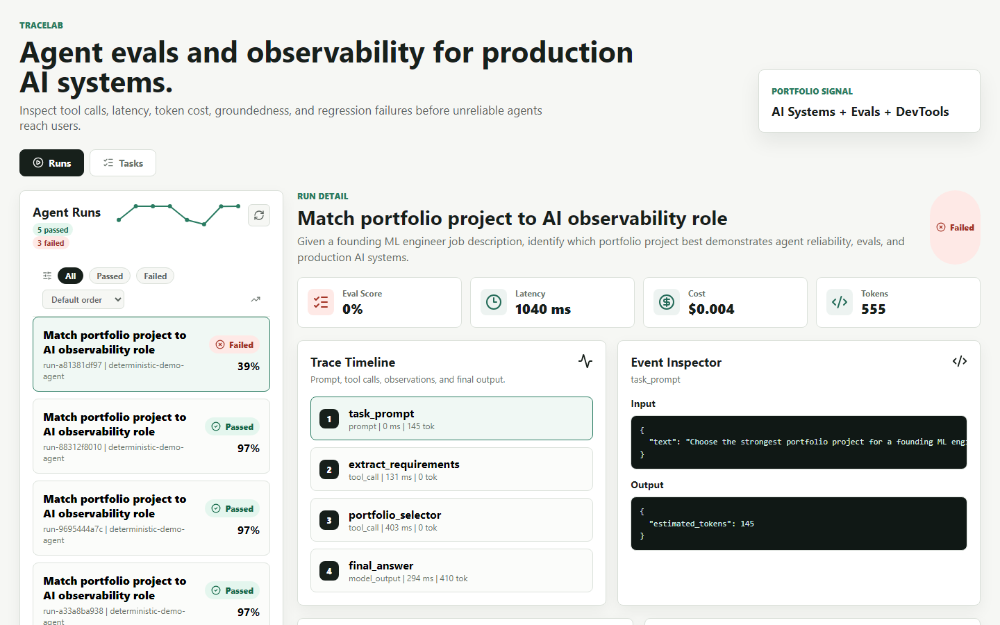

# TraceLab

AI agent evaluation and observability dashboard.



TraceLab is a portfolio-grade developer tool for inspecting AI agent runs. It captures model prompts, tool calls, observations, final outputs, latency, token usage, estimated cost, and eval results so agent failures are easy to debug.

## Why This Exists

AI agents fail in ways normal app logs do not explain: wrong tool arguments, unsupported claims, hidden latency spikes, excessive cost, and regressions that only appear after a prompt or model change. TraceLab makes those failures inspectable and testable.

## What It Shows

- Agent run dashboard with pass/fail status
- Trace timeline for prompts, tool calls, tool results, and final output
- Event inspector with structured JSON inputs and outputs
- Evaluation cards for answer quality, groundedness, tool correctness, latency, and cost
- Regression comparison between latest and baseline runs
- Seeded examples showing both a good run and a failed run
- CLI quality gate for CI

## Architecture

```text
example agent
    |
    | emits prompts, tool calls, outputs, evals
    v
TraceLab Python SDK
    |
    | POST /runs, /events, /evals
    v
FastAPI + SQLite
    |
    | GET /runs, /runs/{id}, /regression/{task}
    v
React dashboard
```

## Demo Flow

1. Start the API and dashboard.
2. Run a passing trace with `python examples\research-agent\agent.py --mode good`.
3. Run a failing trace with `python examples\research-agent\agent.py --mode bad`.
4. Open the dashboard and compare the good/failing traces.
5. Run the eval gate and watch the bad run fail CI-style.

## Stack

- Frontend: React, TypeScript, Vite
- Backend: FastAPI, SQLite
- Data: seeded trace and eval records

## Run Locally

Install backend dependencies:

```powershell
python -m pip install -r apps\api\requirements.txt
```

Install frontend dependencies:

```powershell
npm --prefix apps\web install
```

Start the API:

```powershell
python -m uvicorn tracelab_api.main:app --reload --host 127.0.0.1 --port 8000 --app-dir apps/api
```

Start the dashboard:

```powershell
npm --prefix apps\web run dev
```

Open:

```text
http://127.0.0.1:5173
```

## Generate A New Trace

With the API running, execute the deterministic research-agent demo:

```powershell
python examples\research-agent\agent.py --mode good
```

Generate a deliberately bad run:

```powershell
python examples\research-agent\agent.py --mode bad
```

## Run The Eval Gate

This command runs the example agent, fetches the stored eval results, prints a quality report, and exits nonzero if the run fails the configured gate.

```powershell
$env:PYTHONPATH="packages\evals"
python -m tracelab_evals.run_eval --mode good --min-score 0.75 --max-failed 0
```

Deliberately fail the gate:

```powershell
$env:PYTHONPATH="packages\evals"
python -m tracelab_evals.run_eval --mode bad --min-score 0.75 --max-failed 0
```

This is the core production signal of the project: AI behavior can be regression-tested before release.

## API

- `GET /health`
- `GET /runs`
- `GET /runs/{run_id}`
- `GET /tasks`
- `GET /regression/{task_id}`
- `POST /seed`

## What Makes This Different From A Chatbot

TraceLab is not the agent. TraceLab is the reliability layer around the agent. It records what happened, scores whether it was acceptable, and makes failures visible enough to debug.

That distinction matters for AI infrastructure roles because production teams need evals, traces, and regression gates more than another demo chat box.

## Resume Positioning

Built TraceLab, an AI agent observability and evaluation platform with trace replay, tool-call correctness scoring, latency/cost analytics, and regression checks for production AI systems.

Additional bullets:

- Implemented a Python tracing SDK and FastAPI backend to capture model prompts, tool calls, observations, token usage, latency, and evaluation results.
- Built deterministic agent eval gates for answer quality, groundedness, required tool use, citation coverage, latency, and cost budgets.
- Designed a React dashboard for inspecting trace timelines, JSON event payloads, eval failures, and baseline-vs-latest regressions.

## Next Improvements

- Add screenshots and an animated walkthrough GIF
- Add OpenAI-compatible live model mode
- Add RAG-specific groundedness examples
- Add trace export to JSON/OpenTelemetry-style format
